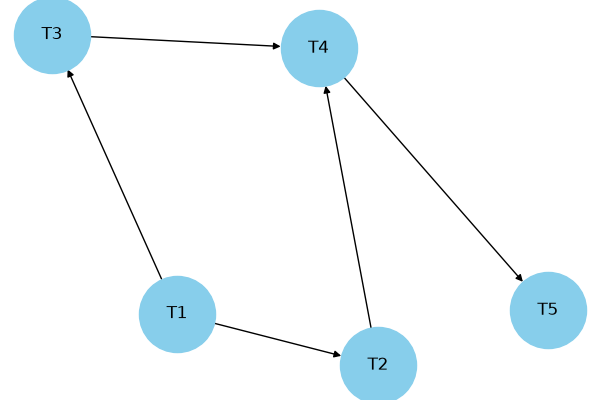
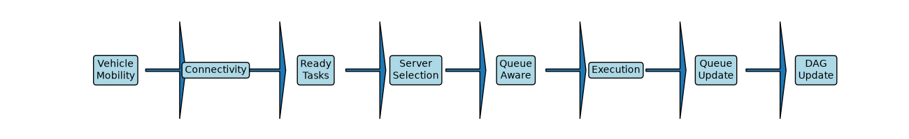
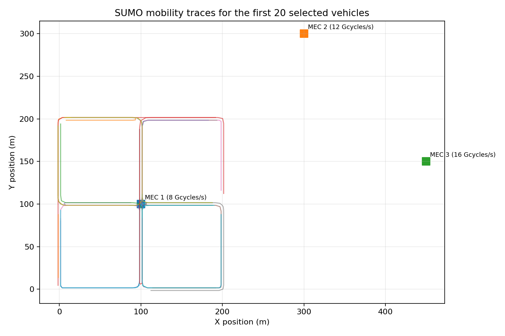
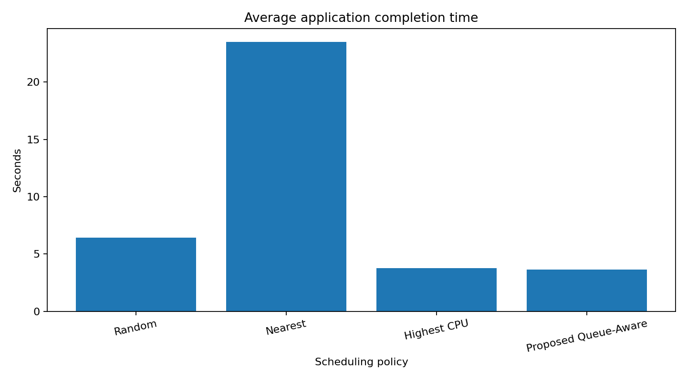
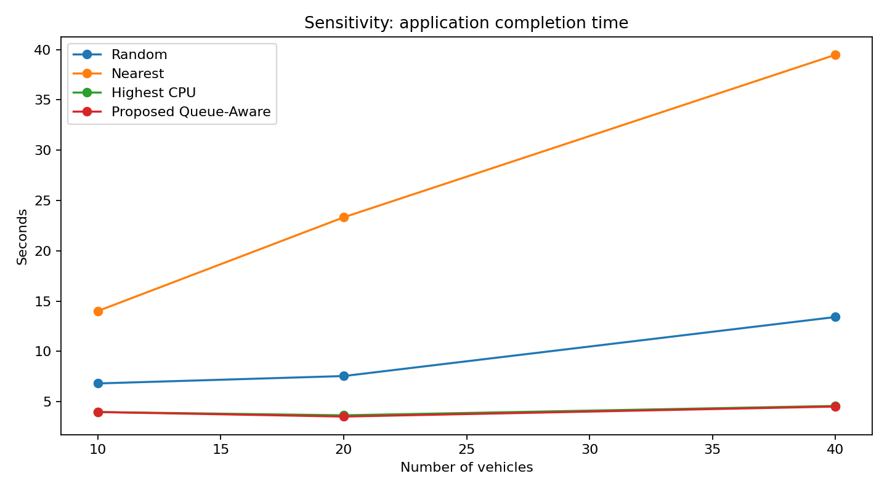

# Queue-Aware Online DAG Scheduling and Task Offloading in Vehicular Edge Computing

## Abstract

Vehicular Edge Computing enables computation-intensive and latency-sensitive applications to offload tasks to nearby Mobile Edge Computing servers. Vehicle mobility, wireless conditions, heterogeneous server capacity and dynamic queues make offloading decisions difficult, particularly when applications contain interdependent DAG tasks. This project implements a trace-driven queue-aware online scheduling and task-offloading simulation. It replays SUMO mobility traces, identifies dependency-ready tasks, ranks tasks by estimated critical-path length, screens MEC servers using communication coverage and estimated contact time, predicts queue-plus-service workload, and selects a feasible server using an earliest predicted completion-time heuristic. MEC CPU capacity is shared among active tasks in proportion to their critical-path ranks. The implementation is compared with Random, Nearest and Highest-CPU server-selection baselines and evaluated across multiple task-generation seeds and selected vehicle counts. The proposed method is a heuristic for the stated completion-time minimization problem, not an exact global optimizer.

## 1. Introduction

Mobile Edge Computing places computational resources closer to mobile users. In vehicular edge computing, vehicles generate computation-intensive and delay-sensitive applications while continuously moving through the coverage regions of roadside edge servers. A server with a high CPU capacity may still produce a long application delay when its queue is congested. Similarly, selecting a server based only on distance may ignore computational workload and remaining connectivity time.

Applications may consist of multiple dependent tasks. A task cannot begin until all of its predecessor tasks have completed. Therefore, scheduling individual tasks without respecting the DAG can violate application dependencies or delay the final application completion time.

## 2. Objective

**Objective 2:** Design a queue-aware online DAG scheduling and task offloading framework that minimizes end-to-end application completion time by jointly optimizing task scheduling, edge server selection and resource allocation under dynamic queue congestion, heterogeneous resources and task dependency constraints.

The implementation approximates this objective using an online heuristic. It jointly considers ready-task priority, server selection and CPU sharing at each simulation step, but it does not solve the global optimization problem exactly.

## 3. System Model

The simulated system contains mobile vehicles and three fixed MEC servers. Each vehicle replays its time, position and speed samples from `sumo/mobility_trace.csv`. The servers have different CPU capacities:

| MEC server | Position (x, y) | CPU capacity |
|---|---:|---:|
| MEC 1 | (100, 100) | 8 billion cycles/s |
| MEC 2 | (300, 300) | 12 billion cycles/s |
| MEC 3 | (450, 150) | 16 billion cycles/s |

The default communication coverage radius is 300 metres. The simulation uses a 20 MHz uplink bandwidth and a simplified distance-dependent wireless model. These are configurable simulation assumptions rather than measured deployment parameters.

## 4. DAG Task Model

Each vehicle generates one five-task application represented by a directed acyclic graph:

```text
        T1
       /  \
     T2    T3
       \  /
        T4
        |
        T5
```



The dependency edges are \((T1,T2)\), \((T1,T3)\), \((T2,T4)\), \((T3,T4)\) and \((T4,T5)\). A task is considered ready only when all predecessor tasks have completed. The default task input size is 2–8 MB, CPU demand is 2–5 billion cycles, and deadline is 20 seconds after the application's release time.

## 5. Mathematical Formulation

Let \(x_{im}(t)\) denote the assignment of task \(i\) to MEC server \(m\), and let \(f_{im}(t)\) denote the CPU rate allocated to that task. Let \(S_i\) and \(C_i^{finish}\) denote task start and finish times. The application completion time is the time at which all tasks have finished, measured from application release.

The application completion time is measured as the last task finish time minus the application's release time. The target objective is:

\[
\min_{x,f,S}\;T_{app}
\]

subject to:

1. **Task dependency:** \(S_i\geq C_j^{finish}\) for every dependency edge \((j,i)\).
2. **One-server assignment:** \(\sum_m x_{im}(t)\leq 1\).
3. **MEC CPU capacity:** \(\sum_i x_{im}(t)f_{im}(t)\leq F_m\) for every server \(m\).
4. **Non-negative allocation:** \(f_{im}(t)\geq 0\).
5. **Connectivity:** an assignment is considered only when the vehicle is within the server's coverage radius.
6. **Mobility feasibility:** estimated upload and server service delay must not exceed estimated remaining contact time.
7. **Deadline:** completed tasks should satisfy their configured deadline.
8. **Queue evolution:** uploaded tasks enter waiting queues and move to execution when server capacity slots become available.

The complete notation and derivation are provided in [`Mathematical_Formulation.md`](Mathematical_Formulation.md).

## 6. Proposed Online Scheduling Heuristic



At each simulation decision step, the framework performs the following operations:

1. Update vehicle positions and speeds using the SUMO trace.
2. Identify tasks whose DAG predecessors have all completed.
3. Compute task-specific critical-path ranks using the task's CPU-cycle demand and the fastest MEC CPU capacity.
4. Consider ready tasks in descending critical-path-rank order.
5. For each reachable MEC server, estimate upload time and current queued/running workload.
6. Estimate remaining vehicle-server contact time and reject candidates that fail the mobility-feasibility condition.
7. Select the feasible server with the smallest estimated upload-plus-server-workload delay.
8. Complete upload and admit the task into the server's waiting queue.
9. Start tasks when execution slots are available and allocate CPU in proportion to running-task critical-path ranks.
10. Update task, queue, server and application completion states.

For a running task, the CPU allocation is:

\[
f_{im}(t)=F_m\frac{Rank(i)}{\sum_{j\in Running_m}Rank(j)}.
\]

This ensures that the total allocated CPU does not exceed the MEC server's capacity. The server supports at most two concurrent running tasks; other uploaded tasks wait in its queue.

## 7. SUMO Integration



The repository includes the SUMO network, route and configuration files, plus the generated mobility trace. The Python MEC simulator reads the CSV trace and replays vehicle positions and speeds. This is offline trace-driven SUMO integration, not live SUMO-TraCI co-simulation. The trace can be regenerated using `sumo/trace_generator.py` when SUMO and its TraCI Python tools are installed.

## 8. Experimental Evaluation

The implementation compares four server-selection policies:

- Random feasible MEC server.
- Nearest feasible MEC server.
- Highest-CPU feasible MEC server.
- Proposed Queue-Aware: feasible server with the smallest estimated upload-plus-queue/service delay.

All policies use the same trace, generated task workload, DAG-ready-task ranking and CPU-sharing rule for a given comparison run. The comparison therefore focuses on the server-selection policy.

In the default 20-vehicle run, the proposed policy completed 20 of 20 applications and achieved a mean application completion time of 3.6500 seconds, compared with 3.7800 seconds for Highest CPU. Mean queue waiting time was 0.2241 seconds for the proposed policy and 0.2489 seconds for Highest CPU. Both policies had zero deadline violations in this run.

A sensitivity experiment evaluates 10, 20 and 40 selected vehicles across task-generation seeds 21, 42 and 84. The proposed method matched Highest CPU in the 10-vehicle scenario and showed modest mean improvements at 20 and 40 vehicles. Full numerical results are in [`Experimental_Results.md`](Experimental_Results.md), with raw data in the `results/` directory.





## 9. Limitations

1. SUMO is integrated through an offline CSV trace; the MEC simulator does not run a live TraCI loop.
2. The wireless model is a simplified distance-dependent path-loss approximation.
3. Contact-time estimation uses speed and distance margin but not vehicle heading or predicted trajectory.
4. Queue delay is estimated from remaining cycles in active and waiting tasks; it is not an exact queueing model.
5. Critical-path CPU allocation is a heuristic, not a globally optimal allocation.
6. The proposed online method is greedy and does not guarantee a global optimum.
7. The current evaluation reuses one mobility trace and varies selected vehicle counts and task-generation seeds; separate SUMO traffic-density scenarios remain future work.
8. The implementation currently models MEC offloading and does not include local vehicle execution or task migration.
9. Result-transmission delay and data transfer between dependent tasks placed on different MEC servers are treated as negligible and are not separately simulated.

## 10. Conclusion and Future Work

The project implements a queue-aware online DAG offloading simulation that combines task dependencies, dynamic MEC queues, heterogeneous CPU capacities, mobility feasibility and critical-path-weighted CPU allocation. The experiments show that the proposed heuristic can improve application completion time and queue waiting time over selected baselines in the configured scenarios, although the measured advantage over Highest CPU is modest. Future work includes live SUMO-TraCI integration, heading-aware contact prediction, calibrated wireless modelling, local execution, task migration, independently generated traffic scenarios and optimization-based benchmark algorithms.

## References

The following two IEEE Xplore links were supplied in the project proposal. Complete bibliographic metadata should be copied from the paper records or PDFs before final academic submission; it should not be guessed.

1. IEEE Xplore document 11002512: <https://ieeexplore.ieee.org/stamp/stamp.jsp?tp=&arnumber=11002512>
2. IEEE Xplore document 10930689: <https://ieeexplore.ieee.org/stamp/stamp.jsp?tp=&arnumber=10930689>
