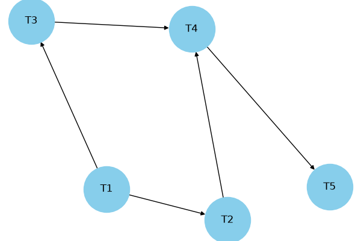
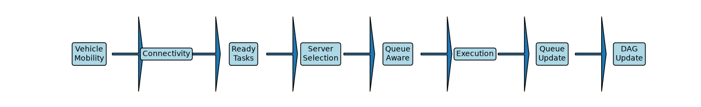
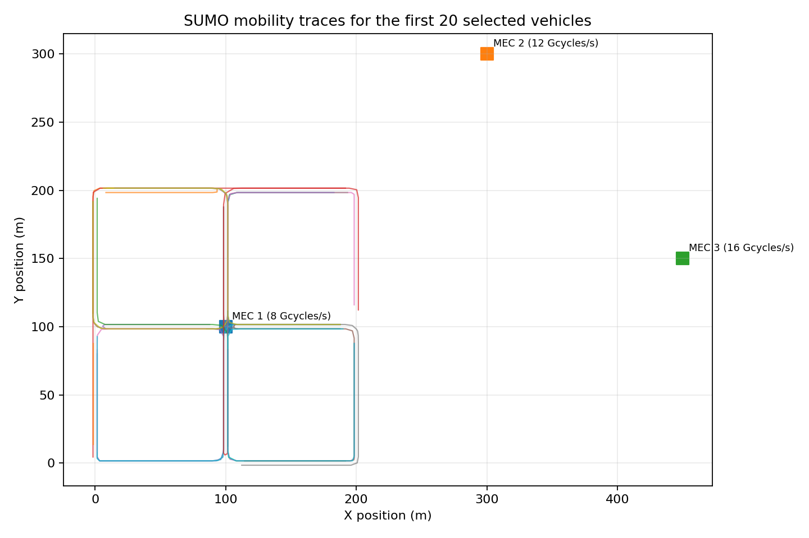
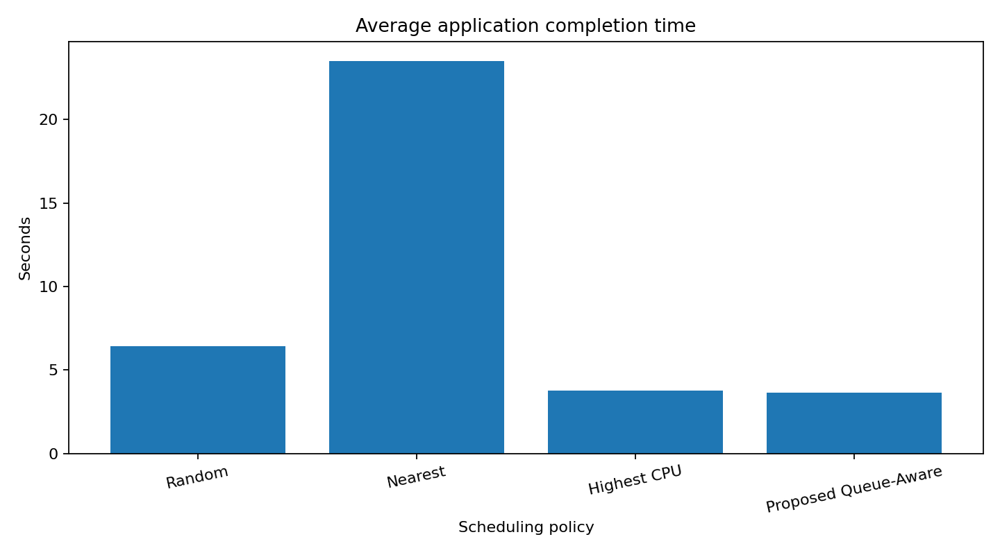
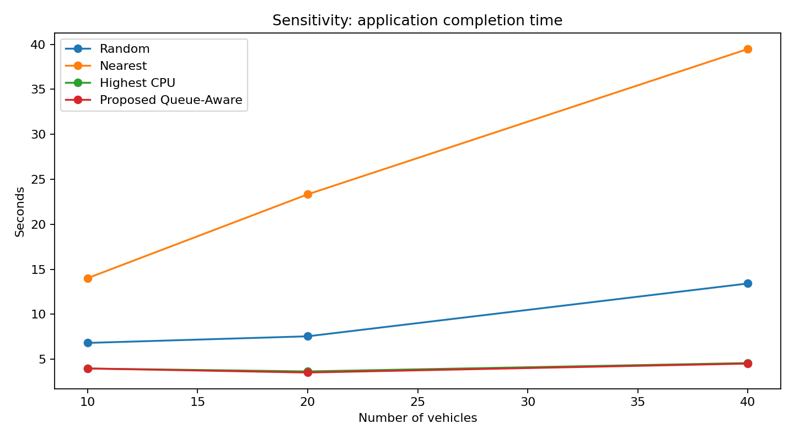

# Queue-Aware Online DAG Scheduling and Task Offloading in Vehicular Edge Computing

## Project objective

Design a queue-aware online DAG scheduling and task-offloading framework that aims to minimize end-to-end application completion time by jointly considering:

- DAG task dependencies and ready-task scheduling;
- MEC server selection under changing queue congestion;
- heterogeneous MEC CPU capacities;
- dynamic CPU sharing among active tasks;
- vehicle mobility and estimated connectivity duration; and
- wireless upload delay.

The project uses a SUMO-generated mobility trace and replays it in a Python MEC simulation.

> **Implementation scope:** The proposed scheduler is an online heuristic for the mathematical minimization problem. It is not an exact global optimizer and does not claim a proof of global optimality. SUMO integration is trace-driven (CSV replay), not live TraCI co-simulation during the MEC run.

## Main features

1. One five-task DAG per vehicle: `T1 -> {T2,T3} -> T4 -> T5`.
2. Dependency-aware scheduling: a task is eligible only after all predecessors finish.
3. Task-specific critical-path ranks based on generated CPU-cycle demands and the fastest MEC CPU rate.
4. Three heterogeneous MEC servers (8, 12 and 16 billion CPU cycles/second).
5. Distance-dependent wireless transmission-rate model.
6. Dynamic per-server waiting queues and up to two concurrently running tasks per server.
7. Critical-path-weighted CPU allocation; allocated CPU shares sum to the server's capacity.
8. Mobility-feasibility screening using a conservative contact-time approximation.
9. CSV outputs for task-level, application-level, server-level and algorithm-comparison results.
10. Baseline comparison and repeated-seed/vehicle-count sensitivity experiments.

## System overview







## Repository structure

```text
Queue-aware-DAG-Scheduling/
├── README.md
├── requirements.txt
├── .gitignore
├── src/
│   ├── phase2_simulation.py
│   ├── algorithm_comparison.py
│   └── run_sensitivity_experiments.py
├── sumo/
│   ├── vec.sumocfg
│   ├── network.net.xml
│   ├── routes.rou.xml
│   ├── trips.trips.xml
│   ├── mobility_trace.csv
│   └── trace_generator.py
├── tests/
│   ├── test_scheduler.py
│   └── test_trace.py
├── results/
│   ├── phase2_task_results.csv
│   ├── phase2_application_results.csv
│   ├── phase2_server_summary.csv
│   ├── algorithm_comparison.csv
│   ├── sensitivity_runs.csv
│   ├── sensitivity_summary.csv
│   └── generated PNG graphs
└── report/
    ├── Abstract.txt
    ├── Conclusion.txt
    ├── Final_Report.md
    ├── Mathematical_Formulation.md
    ├── Implementation_Mapping.md
    ├── Experimental_Results.md
    └── figures/
```

## Uploading to GitHub

See [`UPLOAD_INSTRUCTIONS.md`](UPLOAD_INSTRUCTIONS.md) for the exact upload and verification steps.

## Requirements

- Python 3.9 or newer
- `matplotlib` for plots
- `pytest` for tests
- SUMO is optional if you use the included `sumo/mobility_trace.csv`.

Install Python dependencies from the repository root:

```bash
python -m pip install -r requirements.txt
```

## Run the project

Run commands from the repository root (the directory containing `src`, `sumo`, and `results`).

### 1. Main multi-vehicle simulation

```bash
python src/phase2_simulation.py
```

This reads `sumo/mobility_trace.csv` and writes task, application and server metrics under `results/`.

### 2. Baseline algorithm comparison

```bash
python src/algorithm_comparison.py
```

This compares Random, Nearest, Highest CPU and Proposed Queue-Aware server-selection policies using the same mobility trace and generated workload for each policy.

### 3. Sensitivity experiments

```bash
python src/run_sensitivity_experiments.py
```

This runs all four policies for 10, 20 and 40 vehicles and three task-generation seeds (21, 42 and 84). It writes raw runs and mean/standard-deviation summaries to `results/`.

### 4. Run tests

```bash
pytest -q
```

The tests check DAG dependency readiness, critical-path ranking, CPU-capacity conservation, transmission-rate behavior, mobility-contact estimation and the included SUMO trace format.

## SUMO trace regeneration (optional)

The supplied CSV trace is already included, so SUMO is not required to run the Python simulation. To generate a new trace, install SUMO and make sure the SUMO `tools` directory (containing `traci`) is available to Python. Ensure the `sumo` executable is on `PATH`, or set `SUMO_BINARY` to its full path. Then run:

```bash
python sumo/trace_generator.py
```

The generated trace replaces `sumo/mobility_trace.csv`. The current MEC simulation replays the trace offline; it does not control SUMO live.

## Simulation configuration

The main defaults are defined near the top of `src/phase2_simulation.py`:

- Simulation step: 0.1 seconds
- Selected vehicles in the main run: 20
- Tasks per application: 5
- Input data per task: 2–8 MB
- CPU cycles per task: 2–5 billion cycles
- Task deadline: 20 seconds after that vehicle's application release
- MEC CPU capacities: 8, 12 and 16 billion cycles/second
- MEC coverage radius: 300 metres
- Maximum concurrent running tasks per MEC server: 2

These are simulation assumptions, not measured properties of a deployed network.

## Results and interpretation






See [`report/Experimental_Results.md`](report/Experimental_Results.md) for the measured results and limitations. Do not describe a small improvement as statistically significant unless the repeated-run analysis supports that claim. The same fixed SUMO trace is used across the current sensitivity scenarios; vehicle count and task-generation seed are varied, but separate traffic-density traces are not generated.

## References supplied with the project proposal

1. IEEE Xplore document 11002512: <https://ieeexplore.ieee.org/stamp/stamp.jsp?tp=&arnumber=11002512>
2. IEEE Xplore document 10930689: <https://ieeexplore.ieee.org/stamp/stamp.jsp?tp=&arnumber=10930689>

Use the paper PDFs or IEEE Xplore records to add verified author, title, journal/conference, year and DOI details to the final academic bibliography. Do not guess missing citation metadata.

